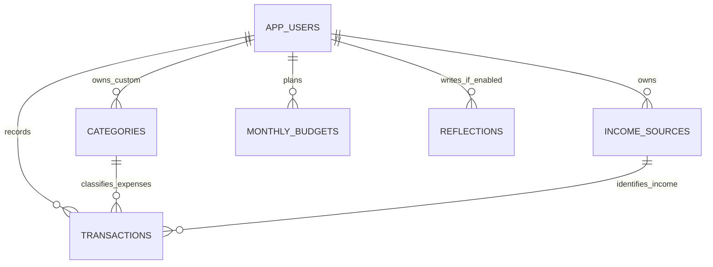

# Entity Relationships

**Status:** Proposed logical ERD — not yet an executable schema

## 1. Proposed logical model

This diagram is logical. It does not decide whether global default categories are stored as shared rows, copied per user, or represented using another pattern.

## 2. Entity descriptions

### `app_users` — existing candidate
Stores account identity and authentication-related data. Inspect the current table before proposing new columns. Password hashes and authentication metadata must never be returned from public API DTOs.

### `categories` — existing candidate
Stores predefined and/or user-created expense categories and their Kakeibo group mapping. The ownership/default-category model is unresolved.

### `income_sources` — proposed
Stores user-managed labels such as salary or freelance work. It is a source label, not a linked bank account.

### `transactions` — proposed
Stores recorded income and expenses if the single-table design is approved. It may contain a type discriminator and optional category/source foreign keys. Alternative: separate income and expense tables. Do not implement both models.

### `monthly_budgets` — implemented (V4, DIV-025)
One row per user and calendar month holding planned income, savings target and the four Kakeibo group allocations (Needs, Wants, Culture, Unexpected) as columns. Replaces the earlier `monthly_plans` + `monthly_group_budgets` proposal. See the [data dictionary](data-dictionary.md).

### `user_preferences` — proposed
Stores editable settings only if they do not fit the approved existing `app_users` design. Avoid duplicating the same preference in multiple places.

### `reflections` — proposed, optional
Stores month-specific reflection answers only if the feature is approved for MVP. Define answer storage, question versioning, and retention before implementation.

### `flyway_schema_history` — managed
Owned by Flyway. Do not manually insert, update, or delete rows as a normal development workflow.

## 3. Relationship constraints to decide

- One monthly plan per user per month: decided (DEC-028), enforced by `UNIQUE (user_id, budget_month)`.
- Four group allocations per plan: decided, enforced by four `NOT NULL` columns.
- Can an income transaction omit an income source?
- Must an expense always reference a category?
- Are default categories global or user-owned copies?
- If a category is deactivated or its group changes, what happens to old transactions?
- Are soft-deleted transactions retained indefinitely or purged after a period?
- Can a reflection have multiple versions or only one current answer set per month?

## 4. Data integrity requirements

- Every user-owned record must have a reliable ownership path.
- Foreign keys must prevent orphaned references where appropriate.
- Add uniqueness constraints only after uniqueness scope is decided.
- Index user/date and user/month access patterns based on real query needs.
- Use transactions when multiple rows must change atomically.
- Keep server-managed timestamps and ownership fields out of user-controlled DTOs.
